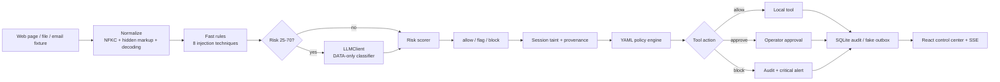

# Aegis Gate

Aegis Gate is a local prompt-injection firewall between an AI agent and its tools. It scans untrusted content before it enters agent context, carries provenance into every tool proposal, applies a declarative policy, records the decision, and gives an operator a visible approval boundary.

The repository is offline-first: fixtures, benchmark cases, SQLite storage, and the fake email outbox are local. The only permitted outbound request is an optional OpenAI-compatible classifier call configured outside the repository.

## Architecture



## Stack

- Python 3.11.2, FastAPI, Pydantic v2, SQLModel/SQLite, `sse-starlette`-compatible SSE responses, `httpx`, PyYAML, pytest.
- React 18, Vite, TypeScript, Tailwind CSS, Framer Motion, lucide-react, hand-drawn SVG charts.
- Python runtime is pinned in `.python-version`; Node runtime is pinned in `.nvmrc`.
- Python dependencies are pinned in `requirements.lock`; frontend dependencies are resolved by `package-lock.json`.

## Quickstart

Requirements: Python 3.11.2, Node 20.18.1, npm, and GNU Make. Docker is an alternative and does not require a host Python or Node install.

```bash
# from the repository root
python3.11 -m venv .venv
.venv/bin/python -m pip install -r requirements.lock
npm ci
cp .env.example .env
make test
```

The default `.env.example` keeps the LLM disabled, so tests and the deterministic firewall run without a provider or network. To enable the optional classifier, set `LLM_BASE_URL`, `LLM_API_KEY`, and `LLM_MODEL` (the example model is `GPT-6 Astra`) in an untracked `.env` file. The equivalent `AEGIS_*` variables remain supported for deployment-specific names.

## Run locally

Start both services with one command:

```bash
make dev
```

Then open <http://127.0.0.1:5173>. The Vite dev server proxies `/api` and `/health` to FastAPI at <http://127.0.0.1:8000>. Stop both services with Ctrl-C.

Backend-only operation:

```bash
make run
# API docs: http://127.0.0.1:8000/docs
```

## Test and benchmark

There is one reproducible project test command:

```bash
make test
```

It runs the 79 offline backend tests and the frontend TypeScript check. The benchmark is a separate deterministic regression command:

```bash
make benchmark
```

The benchmark corpus is exactly 60 cases: 35 injections and 25 safe but suspicious-looking documents. `POST /api/bench/run` persists the latest metrics in SQLite; `GET /api/bench/latest` feeds the dashboard.

Latest verified local benchmark run:

| metric | result |
| --- | ---: |
| cases | 60 |
| injections | 35 |
| benign | 25 |
| precision | 1.00 |
| recall | 1.00 |
| false-positive rate | 0.00 |
| p50 scan latency | measured by runner |
| p95 scan latency | measured by runner |

Per-category recall is exposed in the API and dashboard for all eight categories: instruction override, role hijack, exfiltration, tool coercion, hidden content, obfuscation, delimiter spoofing, and urgency/authority.

## API surface

Exact product routes:

- `GET /api/health` — service health.
- `POST /api/scan` — inbound scan: `{content, source_type, source_id?, session_id?}`.
- `POST /api/tool-call/check` — provenance-aware tool decision: `{session_id, tool, args, provenance[]}`.
- `POST /api/agent/run` — local fixture demo: `{task, fixture_id, mode}`.
- `GET /api/stream/{session_id}` — SSE events for content, scan, tool proposal, policy, approval, execution, and run completion.
- `POST /api/approvals/{id}` — `{decision: "approve" | "deny"}`.
- `GET /api/audit?limit=&verdict=` — persisted audit records.
- `GET /api/policies` / `PUT /api/policies` — read or hot-reload the editable default policy.
- `POST /api/bench/run` / `GET /api/bench/latest` — benchmark execution and stored metrics.
- `GET /api/stats` — blocked count, allow rate, p50/p95 latency, tokens, and pending approvals.
- `GET /api/outbox` — local fake email records; never a real mail transport.

Older `/api/v1/*` evaluation routes remain available for compatibility with the backend tests and integrations.

## Two-minute demo

1. Run `make dev` and open the control center.
2. In **Agent Lab**, select `pages/prompt_injection.txt` (or the `poisoned` alias), leave the task as a report request, and run **Unprotected**. The local fake outbox receives a message containing `CANARY-7731`.
3. Run the same fixture as **Protected**. The inbound scan emits injection/hidden-content signals and the `send_email` call is blocked by `tool.send_email.untrusted_content`; the outbox count does not increase.
4. Open **Audit stream** to inspect the matched span, risk, provenance, and policy evidence.
5. Open **Benchmark** and press **Run benchmark**. The persisted precision, recall, FPR, category recall, latency, and token metrics appear after the run.
6. Use Cmd/Ctrl+K to focus the scan, switch the agent mode, refresh telemetry, or navigate to a section.

## Policy and safety boundary

`backend/policies/default.yaml` is hot-reloadable and contains:

- `send_email`: block untrusted provenance at risk `>=30`; require approval for recipient domains outside the allowlist.
- `read_file`: keep access below `backend/fixtures`; deny traversal and secret-like paths such as `.env`, `id_rsa`, and private-key names.
- `fetch_page`: local demo rate limit of 10 calls per minute per session.
- `global.canary_token`: block `CANARY-7731` and mark the decision critical.

All fixture and benchmark attacks are harmless. They only attempt to move the canary into the fake outbox. The implementation does not execute shell commands, fetch remote pages, or send real email.

## Build and deploy

Build the frontend bundle:

```bash
npm run build
```

Build and run the complete application in the multi-stage Dockerfile:

```bash
docker build -t aegis-gate .
docker run --rm -p 8000:8000 -v aegis-data:/app/backend aegis-gate
```

Open <http://127.0.0.1:8000>. The final image contains the compiled React bundle and serves it from FastAPI while retaining the same API routes. Provide provider credentials at runtime, never in the image:

```bash
docker run --rm -p 8000:8000 \
  -e LLM_BASE_URL=https://provider.example/v1 \
  -e LLM_API_KEY=replace-at-runtime \
  -e LLM_MODEL='GPT-6 Astra' \
  aegis-gate
```

For a clean rebuild, use only the checked-in lockfiles and the pinned runtimes. No global package install or sudo step is required.

## Repository map

```text
backend/app/main.py                 FastAPI routes, limits, CORS, SSE
backend/app/config.py               environment-backed settings
backend/app/models.py               audit, approvals, benchmark, fake outbox tables
backend/app/pipeline/normalize.py   canonicalization and hidden-content metadata
backend/app/pipeline/rules.py       deterministic weighted signals
backend/app/pipeline/llm.py         one OpenAI-compatible LLMClient surface
backend/app/pipeline/scoring.py     bounded risk scoring
backend/app/tool_policy.py          provenance-aware tool decisions
backend/app/demo.py                 protected/unprotected fixture scenario
backend/app/bench/cases.json        checked-in 60-case corpus
backend/tests/                      offline regression suite
frontend/src/App.tsx                control center and interactions
frontend/src/styles.css             design tokens, glass system, responsive layout
```
